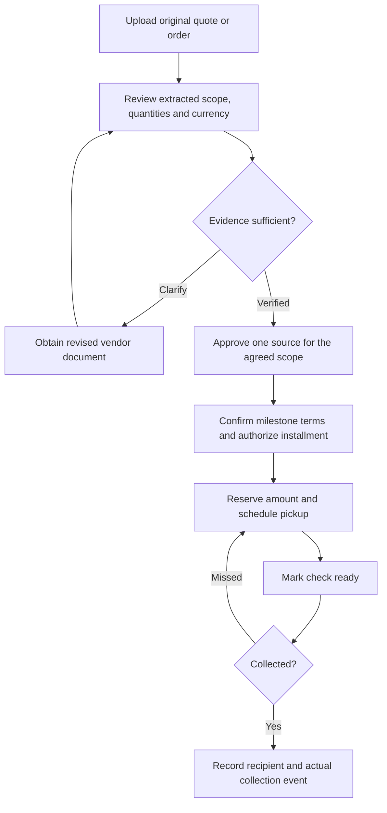

# Palomite business model and vendor workflow

The initial buyer is an owner led construction team managing multiple vendors. Pilot one active project for a fixed fee, then test a workspace subscription priced by active projects with an included document page allowance. Measure cost per reviewed document, minutes to approve a quote, material corrections, repeat use and renewal. Pricing and demand are pilot hypotheses.

Original files are stored in R2, with reviewed lines, source page numbers, approval timestamp, appointments and event history in D1. The current access model is the authenticated account's project records. New installments require an approved source. Amounts are reserved at scheduling through the existing atomic balance check. Collection changes the allocation category while preserving the available balance. Distinct references can represent the same commercial scope, so reviewers must choose one commitment for it. Receiving an invoice does not create additional spending authority.

Milestone satisfaction is attested by the operator. Independent team roles, linked milestone evidence, formal quote supersession and subscription billing are future work.
